<p align="center">
  
</p>

<h1 align="center">FeldKit</h1>

<p align="center"><b>A field kit for people who work with drives.<br>
Open Mac, Windows and Linux drives on your Android phone, play and check what is on them, and copy it off with proof.</b></p>

<p align="center">
  <a href="https://github.com/xpayder/FeldKit/releases/latest"></a>
  <a href="https://github.com/xpayder/FeldKit/actions/workflows/ci.yml"></a>
  
  
  
</p>

<p align="center">
  <a href="#download">Download</a> ·
  <a href="#what-it-does">What it does</a> ·
  <a href="#formats">Formats</a> ·
  <a href="#safety-and-privacy">Safety and privacy</a> ·
  <a href="#build-from-source">Build</a>
</p>

<table>
  <tr>
    <td width="25%">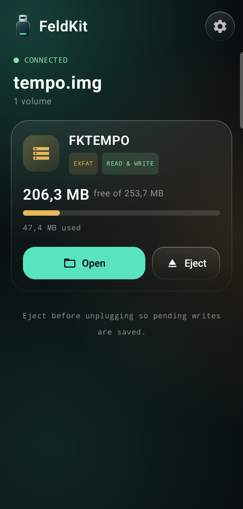</td>
    <td width="25%">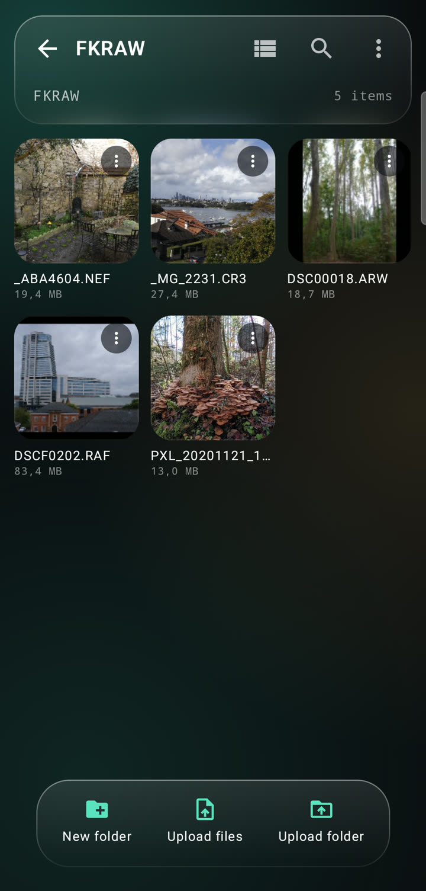</td>
    <td width="25%">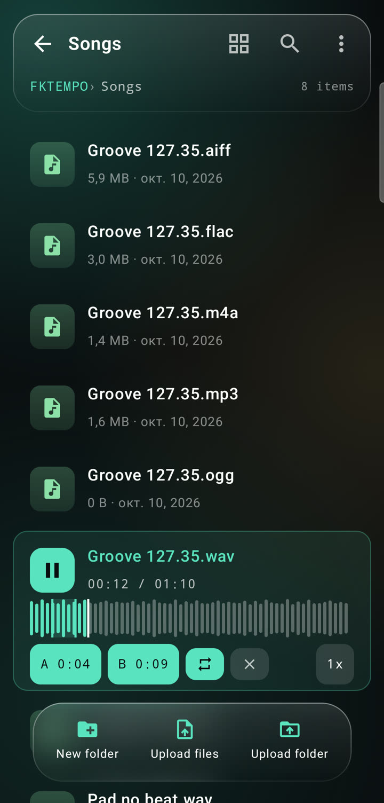</td>
    <td width="25%">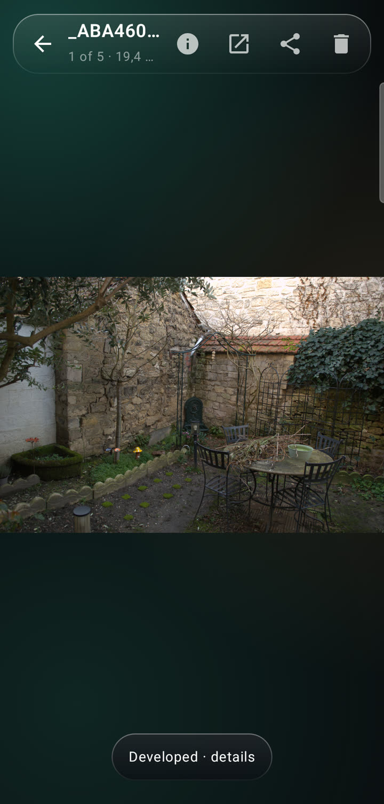</td>
  </tr>
</table>

Musicians, sound designers, photographers, videographers and DITs, designers, developers: when the laptop is not around,
plug an SSD or a card reader into the phone over USB-C, and FeldKit shows the files, plays and previews them, tells you
what is inside, and copies them with a check that nothing got corrupted. Free, open source, no root, no account, and the
app has no internet permission at all.

| You searched for | FeldKit |
|---|---|
| "Android can't read my Mac SSD / APFS drive" | reads APFS and HFS+, writes (experimental) |
| "Android says the drive is unsupported or needs formatting (NTFS)" | reads NTFS, writes (experimental) |
| "open a BitLocker / LUKS / FileVault drive on my phone" | unlocks with the password or recovery key |
| "read a Linux ext4 drive on Android" | reads ext2/3/4, writes (experimental) |
| "copy footage from an SSD to the phone and verify the copy" | checksummed copy, ASC MHL, report |
| "play ProRes / DNxHD / FLAC / AIFF from a USB drive" | built-in player with a libVLC fallback |
| "view RAW photos from a card on my phone" | RAW development (LibRaw), culling, XMP |

## Download

Get the APK from the **[latest release](https://github.com/xpayder/FeldKit/releases/latest)**.

| File | For |
|---|---|
| `FeldKit-<version>-arm64-v8a.apk` | almost every phone made in the last years (start here) |
| `FeldKit-<version>-armeabi-v7a.apk` | older 32-bit phones |
| `FeldKit-<version>-x86_64.apk` | emulators and some Chromebooks |
| `FeldKit-<version>-universal.apk` | if you are not sure (larger) |

Open the file on the phone and allow installing from your browser or file manager when Android asks. Check the download against
`SHA256SUMS.txt` from the same release. Needs **Android 10 or newer** and USB host (OTG) support; a USB-C cable or an OTG
adapter, and a powered hub for large bus-powered drives. Releases are built and signed by GitHub Actions
([how](#releases)); the signing key's SHA-256 fingerprint is `5B:84:5E:D5:91:CD:B7:08:E6:B2:FA:FF:D4:A3:2B:1F:36:CF:96:21:B2:D4:B1:80:2A:ED:11:4D:2C:C9:92:60`.

## What it does

### Open any drive

Plug in the drive and FeldKit mounts it: several partitions at once, disk images (`.iso`, `.dmg`, `.img`) opened from
inside a drive, encrypted drives unlocked with a password or a recovery key. You get a file browser with list and grid
views, search, sorting in both directions, selection by tapping the icon, and a bar of actions that follows what you have
selected. Writing is there too (add files, new folder, rename, delete) for the formats listed [below](#formats).

<table>
  <tr>
    <td width="33%">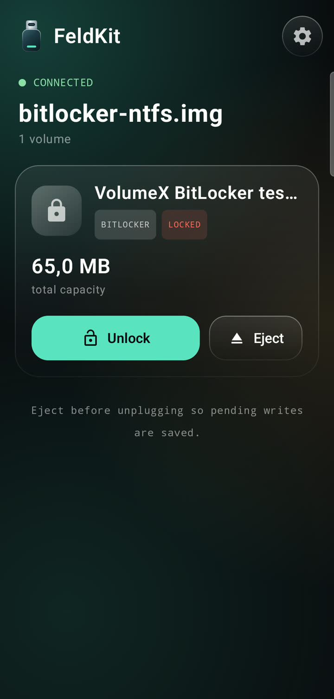</td>
    <td width="33%">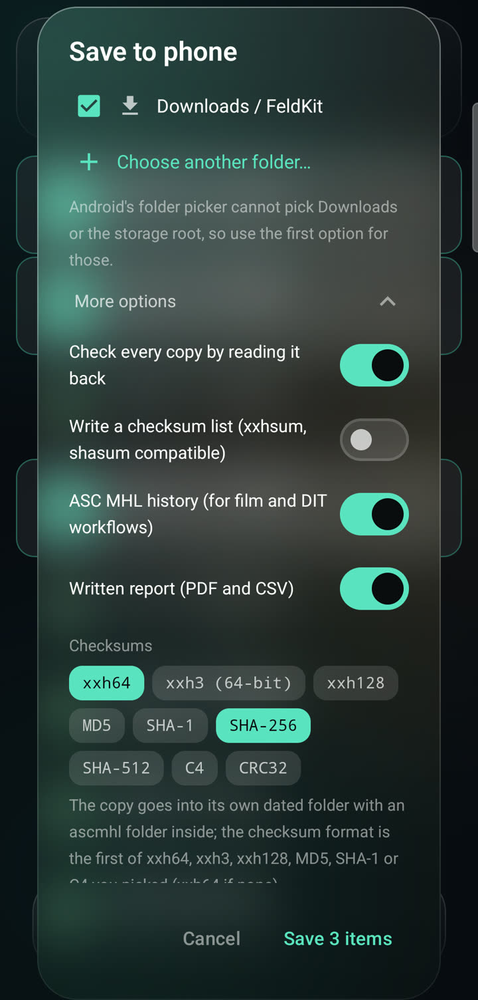</td>
    <td width="33%">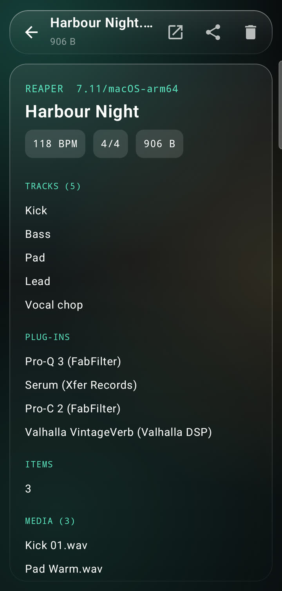</td>
  </tr>
</table>

### For video and DIT

- **Copy with proof.** Each file is read from the drive once, hashed on the way, written to every destination at the same time (the phone's Downloads, an SD card or any folder the system picker offers), and read back to compare. Checksums: xxHash (xxh64, xxh3, xxh128), MD5, SHA-1, SHA-256, SHA-512, C4, CRC32.
- **The paperwork DIT workflows expect.** ASC MHL 2.0 history (checked with the reference `ascmhl` tool), `xxhsum`/`shasum`-compatible checksum lists, and a written report as PDF and CSV.
- **Fast reads.** Pipelined USB transfers read at around 250 MB/s from a USB 3 SSD on a Galaxy S21 FE (measured).
- **Playback.** Hardware decoders first; when the phone has none for a file (ProRes, DNxHD / MXF, FFV1, WMV, FLV, DivX) FeldKit switches to the libVLC software player by itself.
- Not there yet: timecode and frame stepping, LUT preview, camera-card clip grouping (see the [roadmap](docs/ROADMAP.md), written in Russian).

### For people who make music

<table>
  <tr>
    <td width="33%"></td>
    <td width="33%">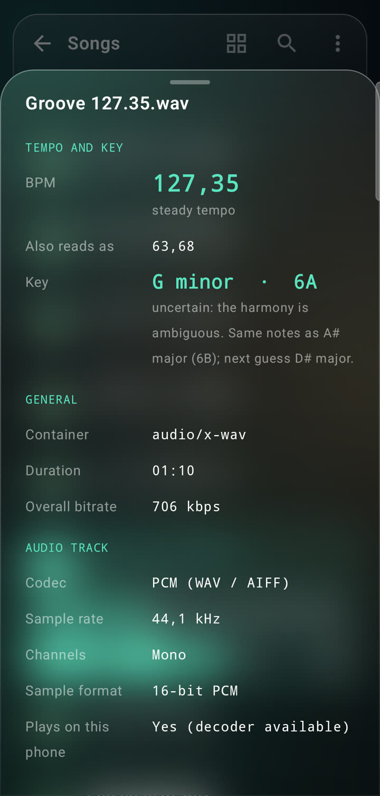</td>
    <td width="33%"></td>
  </tr>
</table>

- **Real BPM of any audio file** (mp3, m4a/aac, flac, wav, aiff, ogg, opus...), measured on the phone, shown next to the tempo tag when the file has one, because a tag is often a rounded number. Loops cut to whole bars are locked to the exact tempo they came from. Tracks without a steady beat say so instead of guessing.
- **Musical key** in both notations, e.g. "F# minor · 11A" (Camelot), with the key that shares the same notes and the next best guess. MIDI files are read from their notes.
- **Waveform that is also the seek bar** (the sound follows your finger), **A-B loop** without a gap, speed from 0.5x to 1.5x with the pitch kept. Markers are remembered per file.
- **MIDI plays** as a piano, or as a drum kit for drum parts (GM channel 10, kit patterns, files named "Hi Hat 12"), synthesised by FeldKit so it sounds the same on every phone.
- **What is inside a music project**, without the DAW: Ableton Live (`.als`), FL Studio (`.flp`) and REAPER (`.rpp`): DAW and version, tempo, meter, tracks or channels, plug-ins, samples, scenes.
- **Field-recorder and loop metadata in WAV**: scene, take, tape, notes and track names (iXML), description, originator and start timecode (BWF), root note and loops (sampler), Acid data, marker count.

**How accurate is it?** BPM: on synthetic tracks with a known tempo the error is at most 0.01 BPM; on 450 real loops from sample packs whose names state their tempo, about 79 % are exactly right and 9 % land on half or double time (the other reading is listed under "Also reads as"). Key: on 184 loops with the key in the name, about 35 % match exactly and 45 % match or land on the relative key, and 24 of 24 on synthetic chord progressions. Loops of one or two notes, bass and drums are the weak spot, so a doubtful key says "uncertain" and always lists the alternative. The checks are in `tools/make-tempo-real.py`, `tools/make-key-labels.py`, `TempoTest` and `KeyTest`.

### For photographers

<table>
  <tr>
    <td width="33%"></td>
    <td width="33%">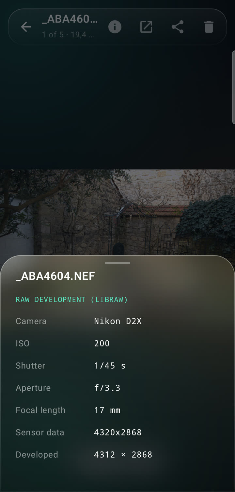</td>
    <td width="33%">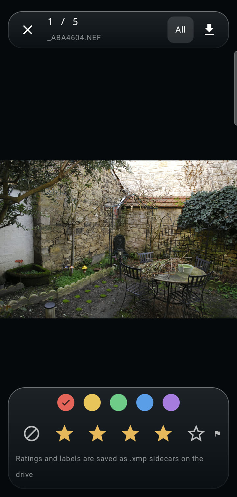</td>
  </tr>
</table>

- **Develop RAW files.** Tap "Develop RAW": the real sensor data is decoded with LibRaw (camera white balance, demosaic, sRGB) in a few seconds, with camera, lens, ISO, shutter and aperture in the details. Checked on Canon (CR3), Nikon (NEF), Sony (ARW) and Fujifilm (X-Trans RAF); files above 60 MB are developed at half size to fit in memory. The embedded preview shows at once, DNG opens natively.
- **Cull a shoot.** Menu > "Cull photos": swipe through the folder, give stars, reject, flag, set a colour label; filter by rating; "save these photos" copies exactly what the filter shows together with their sidecars.
- **Ratings travel with the files.** On a writable drive, stars and labels are saved as `.xmp` sidecars (`xmp:Rating`, `xmp:Label`), the fields Lightroom, Bridge and Capture One read. An existing sidecar is edited in place, so develop settings and keywords stay untouched (checked with `exiftool`).
- **Histogram with clipping warnings**, EXIF, and "Open in Maps" next to the GPS position.

### For developers

<table>
  <tr>
    <td width="33%">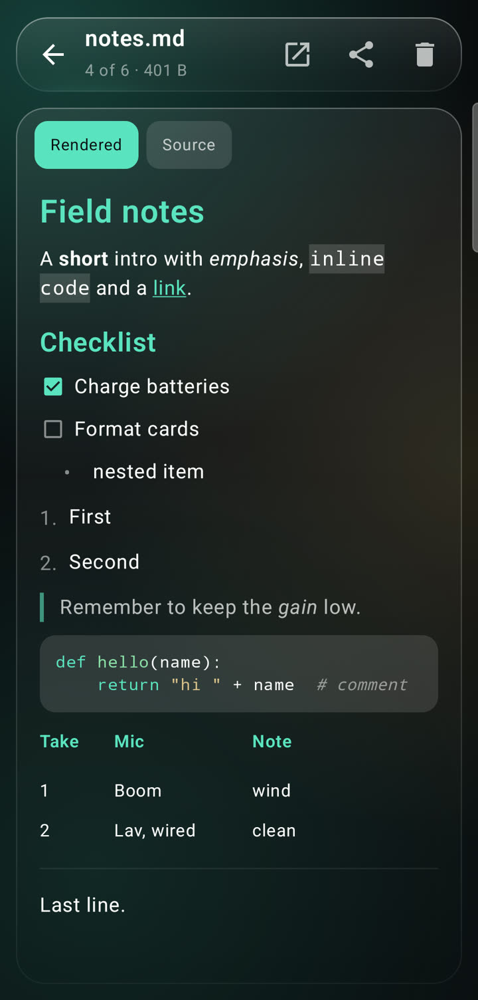</td>
    <td width="33%">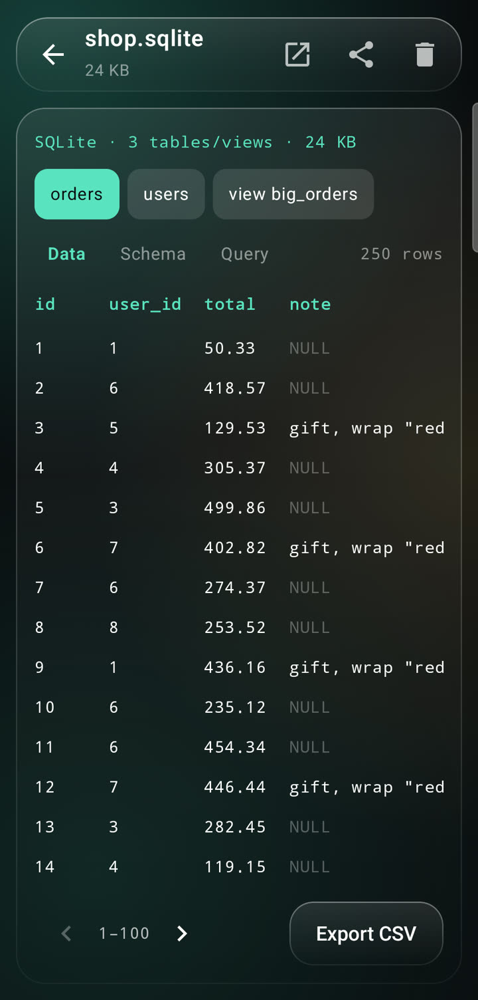</td>
    <td width="33%"></td>
  </tr>
</table>

- **Source you can read:** syntax colours for Kotlin, Java, C/C++, C#, JavaScript/TypeScript, Python, Rust, Go, Swift, shell, Ruby, PHP, Lua, SQL, CSS, JSON, XML/HTML, Markdown, YAML, TOML, INI, Makefile and Dockerfile; search with regex, case and `:123` to jump to a line.
- **Structured files:** JSON and property lists (XML and Apple's binary `bplist00`) as a collapsible tree (long-press copies the path, e.g. `$.items[2].name`), CSV/TSV as a table, Markdown rendered; each with a switch to the source.
- **SQLite** (`.sqlite`, `.sqlite3`, `.db`, Core Data): tables, views, schema, rows page by page, `SELECT` queries, CSV export. Opened read-only.
- **Edit a text file on the drive** (writable drives, up to 512 KB) with undo and redo. A save is careful: the file must be unchanged since you opened it, the old content is kept inside FeldKit, the new content is written beside it and read back byte for byte before it replaces the original (encoding, BOM and line endings are kept).

### Everything else

Archives (zip, 7z, tar, gz, bz2, xz, rar) browse and extract in place; PDFs, images (GIF, SVG, PSD preview), plain text and a hex viewer open inside the app; other apps can reach the files through "Open with", Share and the system file picker. Interface: one frosted-glass style everywhere, built with Jetpack Compose and Haze.

## Formats

| Format | Read | Write |
|---|:---:|:---:|
| exFAT, FAT32, HFS+ | yes | yes |
| APFS | yes | experimental |
| NTFS | yes | experimental |
| ext2 / ext3 / ext4 | yes | experimental |
| BitLocker (Windows 7+, To Go) | yes (password or recovery key) | experimental |
| LUKS 1 / 2, LVM 2 | yes (passphrase) | experimental |
| FileVault (APFS) | yes (password or recovery key) | no |
| ISO 9660, UDF, `.dmg` | yes | no (optical images, compressed images) |

"Experimental" means off by default (Settings > Experimental), verified against independent tools (`fsck_apfs`, `ntfs-3g`, `e2fsck` and a real Linux kernel, `dislocker`, `cryptsetup`) but not against the systems' own drivers in every case, and a power loss or an unplugged cable during a write can leave a drive needing repair. Back up first. What each format supports exactly, its limits and how every claim is checked: **[docs/VERIFICATION.md](docs/VERIFICATION.md)**.

## Safety and privacy

- **No internet permission.** The app cannot send anything anywhere; there is no analytics and no account. (The manifest says so: `INTERNET` is not requested.)
- **Passwords are used once**, to unlock the drive in memory, and are not saved.
- **Writing is conservative.** Writers refuse volumes that are not in a clean state (journal needing recovery, hibernated NTFS, snapshots...) and say why on the drive card. Eject before unplugging.
- **Copies are verified** by reading them back; a mismatch is reported file by file.

## Build from source

```bash
./gradlew :app:assembleDebug            # debug APK (arm64)
./gradlew :app:testDebugUnitTest        # unit tests; the disk-image tests skip themselves until the fixtures exist
./gradlew :app:assembleRelease -PallAbis   # optimised release APKs for every ABI (needs a signing key, see below)
```

Needs JDK 17+, the Android SDK (platform 37), NDK 28.2 and CMake 3.22 (the native parts are xxHash and LibRaw). The disk-image tests
use fixtures made by the scripts in `tools/` (macOS tools for APFS/HFS+/exFAT, Docker for ext, LUKS, LVM, BitLocker checks); see
[docs/VERIFICATION.md](docs/VERIFICATION.md). `tools/phone-image.sh` runs the debug app against a disk image on a connected phone.

### Releases

A tag such as `v1.2.0` makes GitHub Actions build the optimised release APKs (`arm64-v8a`, `armeabi-v7a`, `x86_64` and a universal one), sign them and attach them to a GitHub release with `SHA256SUMS.txt` ([`release.yml`](.github/workflows/release.yml)). The signing key comes from repository secrets; `tools/make-release-keystore.sh` creates one on your own machine. Without the secrets the workflow signs with a throwaway key and marks the release as a pre-release, because phones refuse to update an app over a build signed with another key. Every push is built and tested by [`ci.yml`](.github/workflows/ci.yml).

## Project

- [Roadmap and plan](docs/ROADMAP.md) (Russian) · [Architecture overview](docs/ARCHITECTURE.md) · [How formats are verified](docs/VERIFICATION.md) · [Changelog](CHANGELOG.md)
- [Credits](CREDITS.md): FeldKit started as a fork of [VolumeX](https://github.com/FatalPuppet/VolumeX) by Mirko A. Calvi (FatalPuppet), MIT licensed. The original author built the USB transport and the first APFS and HFS+ readers; if this app saves you money or a deadline, consider thanking them. LibRaw (LGPL 2.1 / CDDL 1.0) lives in its own library.
- [MIT license](LICENSE)
